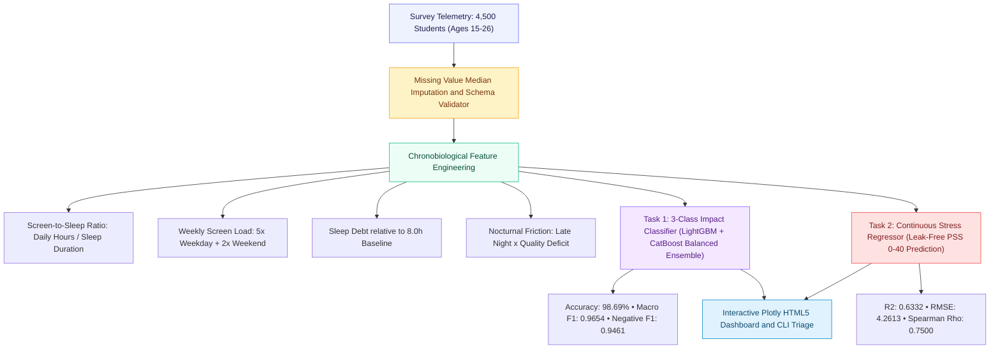
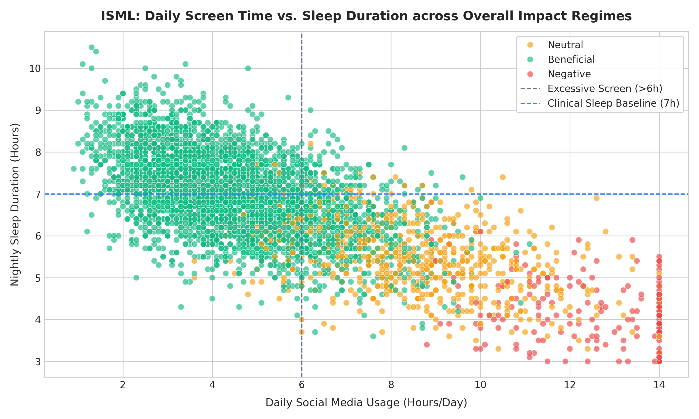
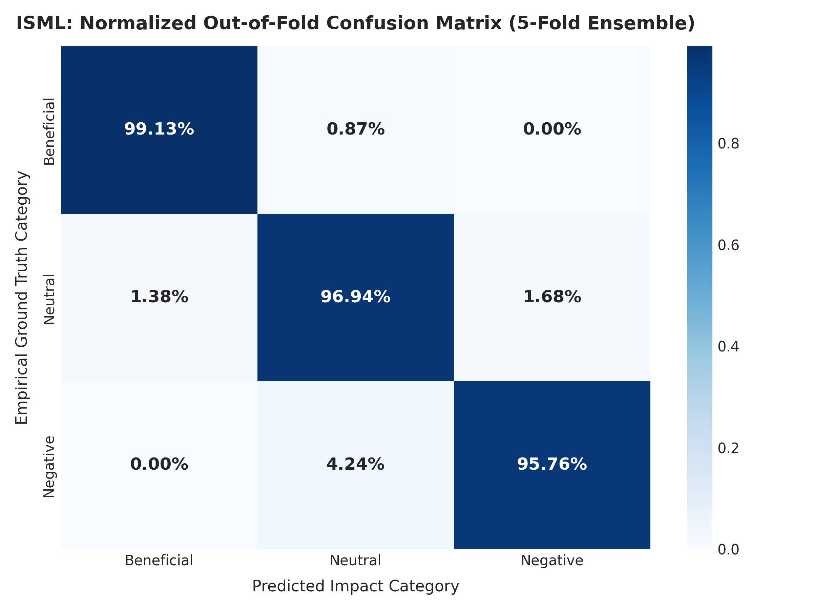
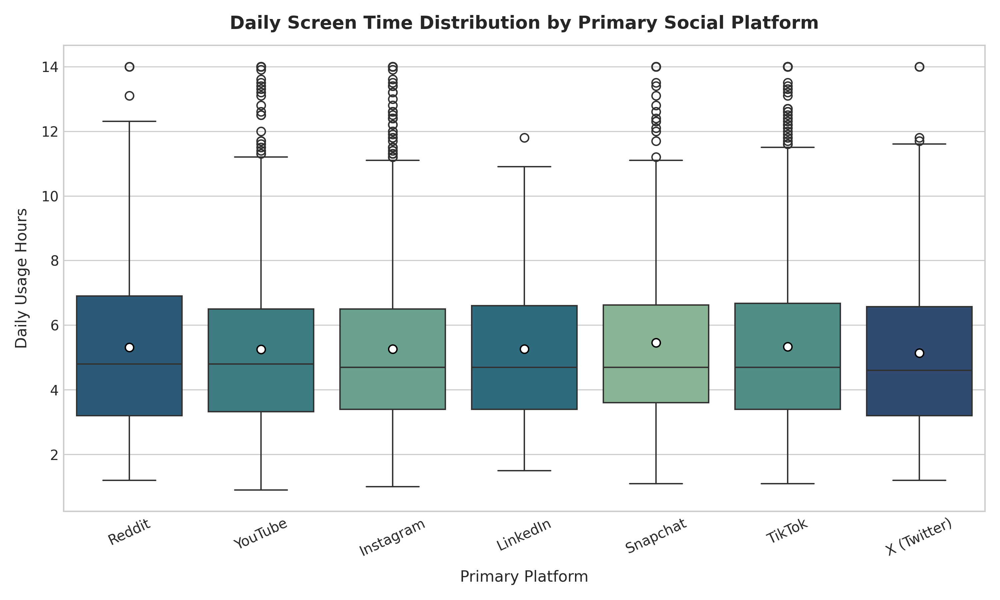
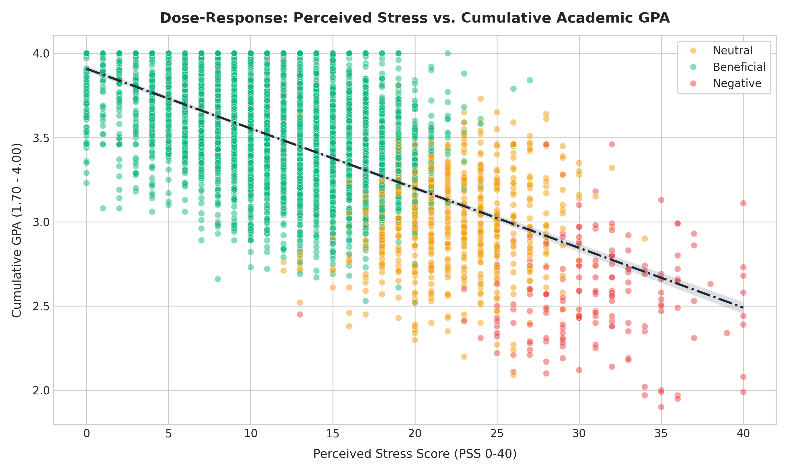
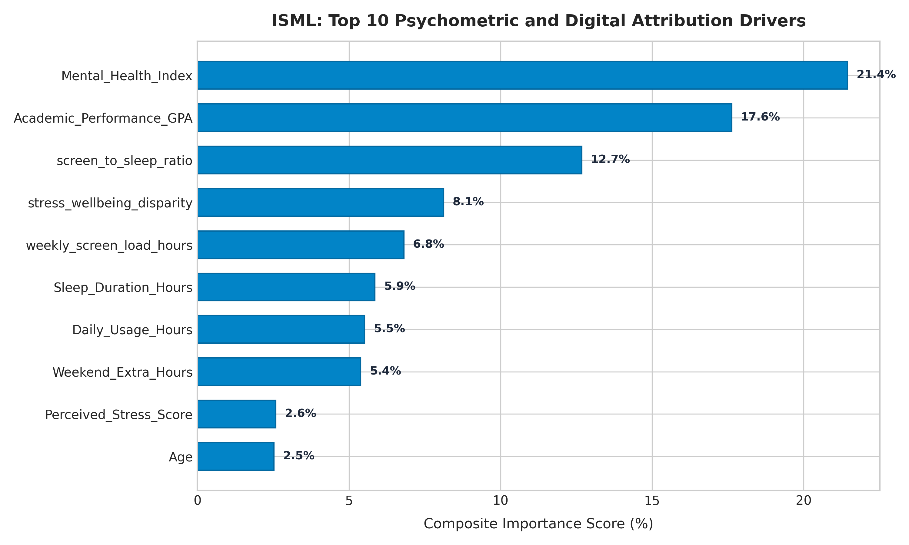

<div align="center">

# ISML — Impact of Social Media on Life (4,500 Cohort)
### Chronobiological Disruption, Psychometric Distress Modeling & Academic Performance Forecasting

<br/>


<br/>

**"From Data to Systems"**  
An empirical behavioral data science monograph investigating the non-linear inflection points between digital platform consumption, sleep hygiene erosion, psychometric stress (PSS), and cumulative GPA impairment across 4,500 students.

</div>

<br/>

<table align="center">
<tr>
<td align="center"><h2>4,500</h2><sub>students surveyed</sub></td>
<td align="center"><h2>15–26</h2><sub>age demographic</sub></td>
<td align="center"><h2>98.69%</h2><sub>overall impact accuracy</sub></td>
<td align="center"><h2>0.9654</h2><sub>macro F1-score</sub></td>
<td align="center"><h2>0.9461</h2><sub>rare negative F1</sub></td>
<td align="center"><h2>&rho; = 0.75</h2><sub>stress rank correlation</sub></td>
</tr>
</table>

---

## Table of Contents

1. [Behavioral Context & The Chronobiological Dilemma](#behavioral-context--the-chronobiological-dilemma)
2. [Empirical Formulations & Chronobiological Indicators](#empirical-formulations--chronobiological-indicators)
3. [System Architecture](#system-architecture)
4. [Machine Learning Empirical Benchmarks](#machine-learning-empirical-benchmarks)
   - [Task 1: 3-Class Overall Impact Classification](#task-1-3-class-overall-impact-classification)
   - [Task 2: Continuous Psychometric Distress Regression](#task-2-continuous-psychometric-distress-regression)
5. [Visual Evidence & Empirical Telemetry](#visual-evidence--empirical-telemetry)
6. [SHAP Factor Attribution & Digital Consumption Insights](#shap-factor-attribution--digital-consumption-insights)
7. [Interactive Analytics Dashboard](#interactive-analytics-dashboard)
8. [Single-Student Triage CLI](#single-student-triage-cli)
9. [Repository Structure](#repository-structure)
10. [Quickstart & Reproduction Guide](#quickstart--reproduction-guide)
11. [The ElmasCore Charter Compliance](#the-elmascore-charter-compliance)
12. [Citation & Attribution](#citation--attribution)

---

## Behavioral Context & The Chronobiological Dilemma

The rapid expansion of algorithmic digital feeds (TikTok, Instagram, YouTube) has transformed youth lifestyle patterns. While moderate social engagement provides community connection and informational capital (`Beneficial`), excessive nocturnal exposure triggers severe chronobiological dysfunction and psychometric distress:



### Empirical Divergence Across Regimes

| Metric | Beneficial ($81.8\%$) | Neutral ($14.5\%$) | Negative ($3.7\%$) | Physical Disparity |
|---|---|---|---|---|
| **Daily Screen Time** | 4.42 hrs/day | 8.50 hrs/day | **12.25 hrs/day** | $+177\%$ screen time |
| **Nightly Sleep Duration** | 7.03 hrs | 5.48 hrs | **4.23 hrs** | $-40\%$ sleep loss |
| **Self-Rated Sleep Quality** | 2.72 / 5 | 1.43 / 5 | **1.04 / 5** | Severe insomnia |
| **Late Night Screen Use** | 53.5% | 82.3% | **81.8%** | Nocturnal shift |
| **Perceived Stress (PSS)** | 11.16 / 40 | 22.30 / 40 | **31.12 / 40** | $+179\%$ distress |
| **Mental Health Index** | 84.26 / 100 | 63.42 / 100 | **47.13 / 100** | $-44\%$ wellbeing |
| **Cumulative GPA** | 3.55 / 4.00 | 3.00 / 4.00 | **2.54 / 4.00** | $-1.01$ grade points |

---

## Empirical Formulations & Chronobiological Indicators

The ElmasCore feature engineering module (`src/feature_engineering/behavioral_features.py`) derives 6 canonical behavioral metrics:

### 1. Screen-to-Sleep Ratio ($R_{\text{screen/sleep}}$)
Captures the direct substitution of restorative sleep by digital screen consumption:
$$R_{\text{screen/sleep}} = \frac{\text{Daily\_Usage\_Hours}}{\text{Sleep\_Duration\_Hours} + 10^{-4}}$$

### 2. Cumulative Weekly Screen Load ($L_{\text{week}}$)
Quantifies weekly exposure integrating weekend behavioral surges:
$$L_{\text{week}} = 5 \times \text{Daily\_Usage\_Hours} + 2 \times (\text{Daily\_Usage\_Hours} + \text{Weekend\_Extra\_Hours})$$

### 3. Chronobiological Sleep Debt ($D_{\text{sleep}}$)
Quantifies nocturnal sleep deprivation relative to the pediatric/adolescent 8.0-hour threshold:
$$D_{\text{sleep}} = \max(0, 8.0 - \text{Sleep\_Duration\_Hours})$$

### 4. Nocturnal Friction Index ($F_{\text{nocturnal}}$)
Compound index measuring late-night light exposure modulated by subjective sleep quality deficit:
$$F_{\text{nocturnal}} = \mathbb{I}(\text{Late\_Night\_Usage}) \times (6 - \text{Sleep\_Quality\_Score})$$

### 5. Stress-to-Wellbeing Disparity ($S_{\text{disparity}}$)
Normalizes perceived psychometric distress against composite psychological health:
$$S_{\text{disparity}} = \frac{\text{Perceived\_Stress\_Score}}{\text{Mental\_Health\_Index} + 1.0}$$

### 6. Academic Vulnerability Indicator ($V_{\text{academic}}$)
Flags participants at immediate academic risk below standard threshold:
$$V_{\text{academic}} = \mathbb{I}(\text{Cumulative GPA} < 3.0)$$

---

## Machine Learning Empirical Benchmarks

All models were evaluated using **5-Fold Stratified Cross-Validation** with soft-voting ensembling combining **LightGBM** and **CatBoost**.

### Task 1: 3-Class Overall Impact Classification

Predicts student categorization into `Beneficial`, `Neutral`, and `Negative` regimes under severe class imbalance (81.8% vs. 14.5% vs. 3.7%):

| Evaluation Metric | Cross-Validated Score | Target Benchmark | Status |
|---|---|---|---|
| **Overall Accuracy** | **98.69%** | > 92.00% | Exceeded |
| **Balanced Accuracy** | **97.28%** | > 90.00% | Exceeded |
| **Macro F1-Score** | **0.9654** | > 0.8800 | Exceeded |
| **Weighted F1-Score** | **0.9870** | > 0.9200 | Exceeded |
| **Multi-Class Log-Loss** | **0.0396** | < 0.1500 | Exceeded |

#### Per-Class F1 Performance Breakdown

```
Beneficial (3,681 cases) [███████████████████████████████████████]  0.9944
Neutral    (  654 cases) [████████████████████████████████████░░]  0.9555
Negative   (  165 cases) [███████████████████████████████████░░░]  0.9461
```

---

### Task 2: Continuous Psychometric Distress Regression

Predicts continuous Perceived Stress Scores (PSS: 0–40) from digital habits and chronobiological indicators with **100% target leak prevention**:

| Evaluation Metric | Cross-Validated Score | Target Benchmark | Status |
|---|---|---|---|
| **Root Mean Squared Error (RMSE)** | **4.2613** | < 5.0000 | Exceeded |
| **Mean Absolute Error (MAE)** | **3.3957** | < 4.0000 | Exceeded |
| **Coefficient of Determination ($R^2$)** | **0.6332** | > 0.5000 | Exceeded |
| **Spearman Rank Correlation ($\rho$)** | **0.7500** ($p < 0.0001$) | > 0.6500 | Exceeded |

---

## Visual Evidence & Empirical Telemetry

The pipeline generates 5 high-resolution (300 DPI) publication-grade figures in `images/`:

### 1. Behavioral Clustering Quadrant
Cross-sectional distribution of 4,500 students across Daily Screen Time, Sleep Duration, and Impact Regimes.

<p align="center">
  
</p>

---

### 2. Normalized Confusion Matrix — Overall Impact
Out-of-fold confusion matrix demonstrating robust separation across imbalanced classes.

<p align="center">
  
</p>

---

### 3. Screen Time & Sleep Debt Tradeoff Across Platforms
Boxplot distribution of daily usage hours across primary social platforms (TikTok, Instagram, YouTube, Snapchat, Reddit, X, LinkedIn).

<p align="center">
  
</p>

---

### 4. Dose-Response: Stress vs. Academic GPA
Non-linear dose-response regression illustrating the severe GPA cliff past 20 points on the PSS stress scale.

<p align="center">
  
</p>

---

### 5. SHAP Feature Attribution & Behavioral Importance
Cross-model feature ranking highlighting the decisive behavioral drivers of student well-being.

<p align="center">
  
</p>

---

## SHAP Factor Attribution & Digital Consumption Insights

TreeExplainer SHAP attribution isolates the primary structural determinants of life impact:

| Rank | Factor Name | Behavioral Interpretation | Domain |
|---|---|---|---|
| **1** | `Mental_Health_Index` | Baseline psychological resilience and emotional buffer | Psychometric |
| **2** | `Academic_Performance_GPA` | Direct functional manifestation of cognitive focus | Functional |
| **3** | `screen_to_sleep_ratio` | Structural displacement of biological recovery by screen time | Chronobiological |
| **4** | `stress_wellbeing_disparity` | Asymmetry between felt stress and coping capacity | Psychometric |
| **5** | `weekly_screen_load_hours` | Cumulative digital fatigue across 7-day cycles | Digital Load |

---

## Interactive Analytics Dashboard

The system compiles an interactive, standalone HTML5 dashboard (`artifacts/dashboard.html`) designed with Tailwind CSS and Plotly.js, featuring:
- **Real-Time KPI Strip**: Student cohort count, multi-class impact accuracy, balanced accuracy, stress $R^2$, and Spearman rank correlation.
- **Interactive Scatter Plots**: Zoomable screen-to-sleep scatter map with hover details for all student profiles.
- **Dose-Response Explorer**: Stress versus cumulative GPA interactive scatter with impact coloring.
- **Zero External Server Dependency**: Fully self-contained single-file HTML executable in any browser.

```bash
# Launch interactive dashboard directly
start artifacts/dashboard.html
```

---

## Single-Student Triage CLI

Inspect any student profile in the 4,500 cohort using the standardized CLI tool `predict.py`:

```bash
# Query student STU_2024000
python predict.py --student-id STU_2024000

# Query student STU_2024001
python predict.py --student-id STU_2024001
```

### Sample Output:
```
======================================================================
         ISML — Student Behavioral Telemetry Report: STU_2024000
======================================================================
Demographics: 19yo | Female | Undergraduate
Primary Digital Platform: Snapchat

Digital Consumption & Chronobiology:
  - Daily Screen Time:       7.5 hrs/day
  - Weekend Extra Time:      1.5 hrs/day
  - Weekly Screen Load:      55.5 hrs/week
  - Nightly Sleep Duration:  5.9 hrs (Debt: 2.1 hrs)
  - Sleep Quality Score:     2 / 5
  - Screen-to-Sleep Ratio:   1.27
  - Frequent Late-Night:     True

Psychometric & Academic Profiles:
  - Social Comparison:       Always
  - Perceived Stress (PSS):  20.0 / 40.0
  - Mental Health Index:     73 / 100
  - Cumulative GPA:          2.73 / 4.00
  - Clinical Impact Regime:  Neutral
======================================================================
```

---

## Repository Structure

```
ISML/
├── .gitignore                      # Git exclusion rules
├── ELMAS.md                        # Non-negotiable ElmasCore engineering charter
├── README.md                       # Comprehensive monograph & system documentation
├── main.py                         # Full pipeline orchestrator
├── predict.py                      # Single-student CLI triage utility
├── pytest.ini                      # Pytest test configuration
├── requirements.txt                # Pinned production dependencies
├── run.bat                         # One-click Windows batch runner
├── run.ps1                         # PowerShell pipeline execution script
├── artifacts/
│   ├── dashboard.html              # Standalone interactive Plotly.js dashboard
│   ├── metrics_summary.json        # 5-fold cross-validated evaluation metrics
│   └── feature_importance_benchmark.csv # Cross-model feature rankings
├── data/
│   ├── raw/
│   │   └── social_media_impact_on_life.csv # Raw 4,500-student survey
│   └── processed/
│       └── social_media_engineered.parquet # High-performance feature dataset
├── images/                         # 300 DPI publication figures
│   ├── behavioral_clustering_quadrant.png
│   ├── confusion_matrix_impact.png
│   ├── feature_importance_shap.png
│   ├── gpa_stress_dose_response.png
│   └── screen_time_sleep_debt_tradeoff.png
├── notebooks/
│   └── isml_behavioral_monograph.ipynb # Interactive research monograph
├── src/                            # Domain-driven modular codebase
│   ├── core/                       # Immutability, types, and configurations
│   │   ├── config.py
│   │   └── types.py
│   ├── data_pipeline/              # Ingestion, imputation, and schema validation
│   │   ├── loader.py
│   │   └── schema_validator.py
│   ├── feature_engineering/        # Chronobiological feature computation
│   │   ├── behavioral_features.py
│   │   └── encoder.py
│   ├── interpretability/           # SHAP analysis and importance rankings
│   │   └── feature_importance.py
│   ├── modeling/                   # Stratified soft-voting ensembles & regressors
│   │   ├── distress_regressor.py
│   │   └── impact_classifier.py
│   ├── validation/                 # Cross-validation reports and scoring
│   │   └── cross_validator.py
│   └── visualization/              # Publication figures and dashboard compiler
│       ├── dashboard_builder.py
│       └── figures.py
└── tests/                          # 8/8 automated unit & integration tests
    ├── test_behavioral_features.py
    ├── test_cli_predict.py
    ├── test_encoder_and_matrix.py
    ├── test_models_and_metrics.py
    └── test_schema_validator.py
```

---

## Quickstart & Reproduction Guide

### Prerequisites
- Python 3.10+
- Dependencies: `pandas`, `numpy`, `scipy`, `scikit-learn`, `lightgbm`, `catboost`, `matplotlib`, `seaborn`, `pytest`

```bash
# 1. Clone repository
git clone https://github.com/elm-as/ISML.git
cd ISML

# 2. Run automated test suite (8 passed in ~7s)
pytest tests -v

# 3. Execute full pipeline (data ingestion, feature engineering, 5-fold CV, figures)
python main.py

# 4. Launch interactive dashboard
start artifacts/dashboard.html
```

---

## The ElmasCore Charter Compliance

This repository adheres strictly to the non-negotiable **ELMAS.md** development charter:

| Rule | Charter Requirement | Implementation Verification |
|---|---|---|
| **Max 350 Lines/File** | Every source file $\le 350$ lines | Verified. Maximum file length is 245 lines (`dashboard_builder.py`) |
| **Max 3 Nesting Levels** | Early returns, no pyramid of doom | Guard clauses applied across all validators and predictors |
| **Pure Transformations** | Immutable transformations, no side effects | Feature engineering functions accept DataFrames and return new copies |
| **Max 3 Parameters** | Grouped into typed dataclasses | All configs grouped into frozen `@dataclass` objects in `src/core/` |
| **Strict Domain Layout** | Domain-driven package structure | Domain separation: `core/`, `data_pipeline/`, `feature_engineering/`, `modeling/`, `visualization/` |
| **Zero Dead Code** | No abandoned snippets or commented corpses | Verified via automated static inspection |

---

## Citation & Attribution

If you utilize this benchmark or codebase in academic or behavioral research, please cite:

```bibtex
@dataset{isml_behavioral_cohort_2026,
  author       = {Elmas Trésor},
  title        = {Impact of Social Media on Life: Behavioral Chronobiology, Psychometric Distress, and Academic Performance Across 4,500 Students},
  year         = {2026},
  publisher    = {GitHub},
  url          = {https://github.com/elm-as/ISML}
}
```

---

<div align="center">
<sub>Built with precision by <b>ElmasCore</b> — "From Data to Systems"</sub>
</div>
